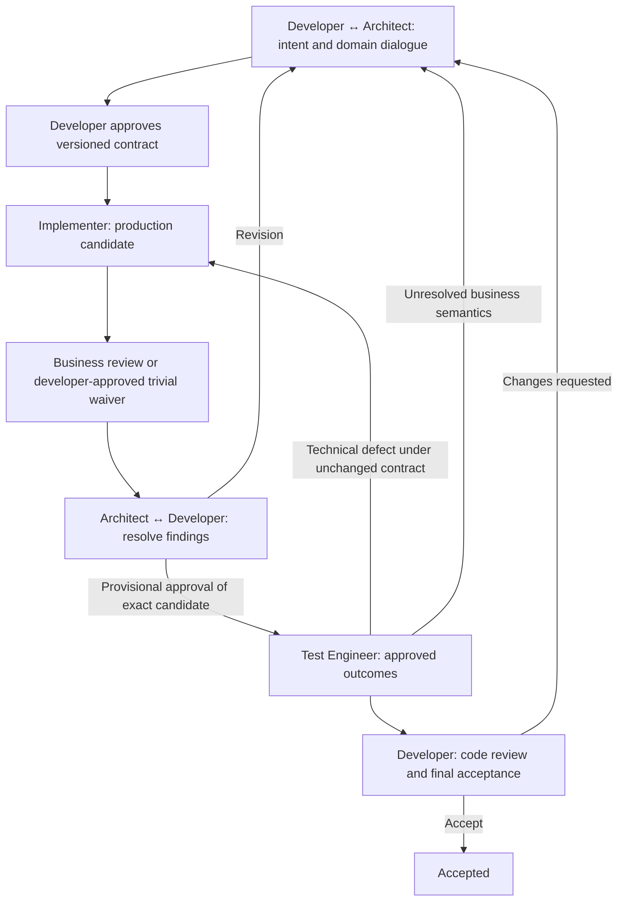

# AGAD

**Architecture-Governed Agentic Development** is a developer-centered operating model for collaborating with AI coding agents.

The developer owns business meaning and final acceptance. The Architect develops shared understanding through dialogue. Supporting roles explore, implement, discover business questions, and test approved outcomes.

Status: **0.1.0 draft specification**, ready for developer review. This repository covers the abstraction only. The core has no harness or provider dependency. A separate experimental [Oh My Pi plugin](integrations/oh-my-pi/README.md) now provides the first technical integration.

## Required workflow



Test scenario planning may begin from the approved contract before implementation finishes. Test writing and execution still require provisional developer approval.

Scout assists the Architect when repository evidence is needed. Six roles do not require six simultaneous processes. Role boundaries and approval gates apply regardless of deployment.

## Read and use

1. Read [principles](docs/principles.md) and [role boundaries](docs/roles.md).
2. Follow the [workflow and gates](docs/workflow.md).
3. Copy the [Living Domain Contract](templates/living-domain-contract.md) for one small change.
4. Exchange [handoff records](docs/handoffs.md), preserving exact contract and candidate references.
5. Record developer decisions using the [approval template](templates/approval.md).
6. Validate records against the [governance rules](docs/governance.md).

[Source invariant audit](docs/invariants.md) · [Worked example](examples/reservation.md) · [machine-readable example](examples/accepted.json) · [DDD grounding](docs/ddd-grounding.md) · [recorded decisions](docs/decisions.md)

## Reference validation

Python 3.10+ standard library only; no installation or network required:

```sh
python3 tools/validate.py examples/accepted.json
python3 -m unittest discover -s tests -v
```

The validator checks record structure, authority declarations, sequence, and evidence freshness. It cannot authenticate a human, inspect production changes, or prove business correctness. A future runtime must enforce permissions and verify approval evidence. Python is a reference-checking choice, not a required implementation language for AGAD.

## Scope

The core specifies responsibilities, terminology, workflow, contracts, escalation, and observable governance requirements. Harness-specific prompts, tool APIs, model identifiers and delegation mechanics stay inside dedicated adapter directories. The first implementation is [integrations/oh-my-pi](integrations/oh-my-pi/README.md); it calls the unchanged core validator. The repository remains private; public distribution and license selection are outside this change. Decisions that need the developer must be asked directly before proceeding.
