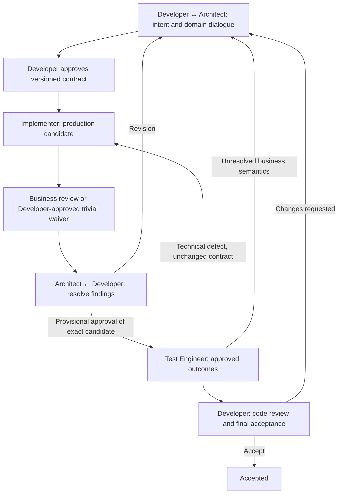

# AGAD for Claude Code

An integration of **Architecture-Governed Agentic Development (AGAD)** designed natively for **Claude Code** (`claude`).

---

## 1. Philosophy: Human Authority, Explicit Gates, Honest Limits

1. **The Developer owns business meaning, architectural approval, code review and final acceptance.** Only an explicit, attributable Developer statement approves a contract revision, review waiver, provisional testing, test gap or acceptance. Silence, permission prompts, agent messages and passing checks are not approval.
2. **The Architect develops shared understanding through dialogue** and asks the Developer directly (`AskUserQuestion`) about business and architectural gaps. Unknown meaning stays unknown.
3. **The gate order is mandatory:** contract approval → implementation → business review or Developer waiver → finding dispositions → provisional approval → tests → code review and acceptance. Early test *planning* is allowed; test writing/execution is not.
4. **Freshness:** revisions are immutable; any production change invalidates review, provisional approval and test evidence. Technical repairs, test-only corrections and revisions each have a defined path.
5. **Native tool restrictions where Claude Code offers them:** the Architect can delegate only to the five AGAD subagents and cannot edit or run shell commands; Scout and Decision Partner cannot edit or run shell commands; the Business Reviewer cannot edit; Implementer and Test Engineer cannot spawn subagents.

### What this integration does and does not enforce
Instructions and tool allowlists define and limit each role. This plugin ships **no hook or state machine**, so it does **not** enforce write paths (Implementer and Test Engineer keep `Edit`/`Write`/`Bash`), does not authenticate approvals, and cannot verify candidate freshness. Those obligations bind each role's instructions and the Architect's coordination, and rely on the Developer to refuse out-of-order work. For machine-checked transitions see the [Oh My Pi integration](../oh-my-pi/README.md) and the [reference validator](../../tools/validate.py).

---

## 2. Specialized Roles

| Role | Agent Config | Model | Effort | Tools | Disallowed | Focus |
| :--- | :--- | :--- | :--- | :--- | :--- | :--- |
| **Architect** | `architect.md` | `claude-opus-5-5` | `medium` | `Read, Glob, Grep, WebSearch, AskUserQuestion, Agent(...)` | `Edit, Write, Bash` | Dialogue, contract, coordination, delegation briefs. |
| **Implementer** | `implementer.md` | `claude-sonnet-5-5` | `medium` | `Read, Edit, Write, Bash, Glob, Grep` | `Agent` | Approved outcomes in approved production paths; local verification. |
| **Business Reviewer** | `business-reviewer.md` | `claude-sonnet-5-5` | `high` | `Read, Glob, Grep, Bash` | `Edit, Write, Agent` | Scenario-first business review; not code review. Bash is for read-only observation only. |
| **Test Engineer** | `test-engineer.md` | `claude-haiku-5-5` | `high` | `Read, Edit, Write, Bash, Glob, Grep` | `Agent` | Independent tests in approved test paths after the gate. |
| **Scout** | `scout.md` | `claude-haiku-5-5` | `low` | `Read, Glob, Grep, WebSearch` | `Edit, Write, Bash, Agent` | Read-only evidence. |
| **Decision Partner** | `decision-partner.md` | `claude-opus-5-5` | `high` | `Read, Glob, Grep` | `Edit, Write, Bash, Agent` | Advisory only. |

---

## 3. Bundled Plugin, Skills & Slash Commands

AGAD is packaged as a standard **Claude Code Plugin**:

- **Manifests**: `.claude-plugin/plugin.json` and root `plugin.json` following the portable Agent Plugins standard.
- **Marketplace**: `.claude-plugin/marketplace.json` enabling installation via `claude plugin marketplace add` and `claude plugin install`.
- **Slash Commands**:
  - `/agad`: Master AGAD workflow command to guide feature lifecycle with the Architect.
  - `/agad-contract`: Drafts, refines, and validates Living Domain Contracts.
  - `/agad-review`: Conducts independent business reviews (derives domain scenarios and edge cases before code inspection).
  - `/agad-test`: Coordinates automated verification against approved outcomes under provisional approval.
- **Skills**:
  - `skills/agad/`: All-in-one AGAD workflow coordinator skill.
  - `skills/agad-contract/`: Living Domain Contract drafting and validation skill.
  - `skills/agad-review/`: Independent business review skill.
  - `skills/agad-test/`: Outcome verification and test engineering skill.

---

## 4. Quickstart & Installation Options

### Option A: Install as a Native Claude Code Plugin (Recommended)
You can install the bundled AGAD plugin directly into your Claude Code environment:

```sh
# One-liner with the setup script:
./integrations/claude-code/scripts/install.sh plugin

# Or manually using native Claude Code CLI commands:
claude plugin marketplace add /path/to/agad/integrations/claude-code
claude plugin install agad@agad
```

Once installed, AGAD slash commands (`/agad`, `/agad-contract`, `/agad-review`, `/agad-test`) and subagents are immediately available in any Claude Code session!

### Option B: Install into an existing project
Run the setup script to copy AGAD subagents, commands, and project instructions into a specific project:

```sh
# Set up in target project root:
./integrations/claude-code/scripts/install.sh project /path/to/your/project

# Or install agents and commands globally into ~/.claude/:
./integrations/claude-code/scripts/install.sh global
```

Then simply open your project in Claude Code:

```sh
cd /path/to/your/project
claude
```

---

## 5. Launching Claude Code with Architect as the Main Agent

You can launch Claude Code with the **AGAD Architect** directly as the primary interactive agent using any of these approaches:

### Method 1: The `--agent` CLI Option (Direct)
```sh
claude --agent architect
```
This immediately launches Claude Code into an interactive session with the Architect persona (`claude-opus-5-5`, Medium effort).

### Method 2: Included Launcher Script & Shell Alias
Run the included launcher script:
```sh
./integrations/claude-code/scripts/launch.sh
```
Or add an alias to your `~/.zshrc` or `~/.bashrc`:
```sh
alias claude-agad="claude --agent architect"
```

### Method 3: Set as Project Default (`.claude/settings.json`)
In your project root, configure `.claude/settings.json`:
```json
{
  "agent": "architect"
}
```
Every time you run `claude` inside this project, it automatically launches with the Architect as the default main agent.

### Method 4: Switch Interactively Inside Any Active Session
If you are already in a running Claude Code session:
- Type `/agent architect` to switch the main agent persona to Architect.
- Or run the `/agad` slash command to start an architecture-governed workflow.

---

## 6. The Collaborative Workflow



### Step 1: Dialogue & Intent Clarification
Start an interactive Claude Code session with `/agad` or mention `@architect`:
- The **Architect** clarifies the desired change and ubiquitous vocabulary.
- If domain concepts, edge cases, or boundaries are ambiguous, the Architect **asks the Developer directly**.

### Step 2: Living Domain Contract
The Architect proposes a versioned contract:
- **Intent**: The observable behavior to achieve.
- **Rationale**: Design decisions and trade-offs.
- **Vocabulary**: Precise domain definitions.
- **Architecture**: Invariants and boundary rules.
- **Requirements**: Concrete, checkable outcomes (`R1`, `R2`, ...).
- **Scope**: Disjoint production paths, test paths, and test commands.

The Developer approves the exact revision explicitly. A meaningful change later means a new revision and fresh approval.

### Step 3: Implementation
The `implementer` agent builds the approved outcomes:
- Edits only approved production paths; may run shell commands and local tests.
- Summarizes files changed, checks run, and outcomes satisfied in natural Markdown.

### Step 4: Business Review
The `business-reviewer` explores real-world domain scenarios and checks for edge cases or potential invariant violations. It reports alignment and surfaces business questions to the Architect and Developer. The Developer may instead waive review for one candidate of a trivial technical change. Every finding needs a Developer disposition.

### Step 5: Provisional Approval & Testing
After review (or waiver) and the Developer's explicit provisional approval of the exact candidate, the `test-engineer` writes and executes targeted automated tests covering the approved outcomes, reporting genuine command outputs.

### Step 6: Code Review & Acceptance
The Developer conducts human code review of the actual diff and test results and may accept or request changes. Any production change after approval makes the candidate stale and repeats review, provisional approval and tests.
