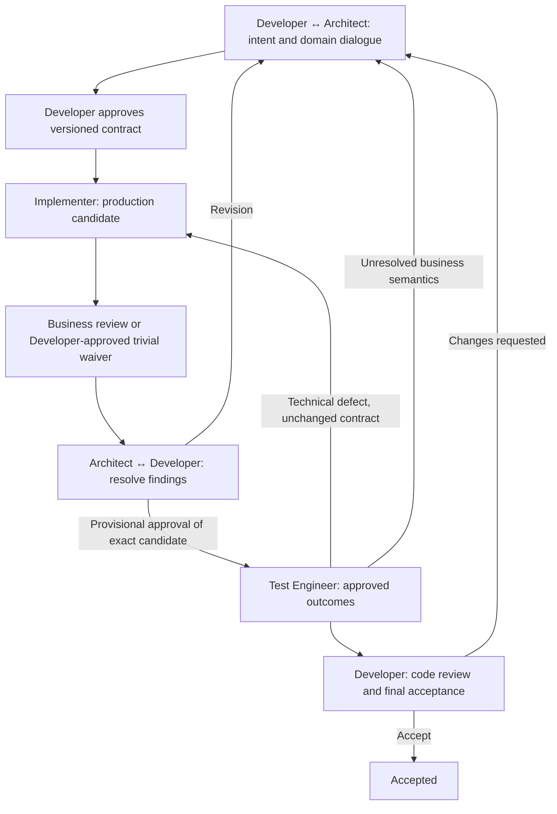

# AGAD for Codex

An integration of **Architecture-Governed Agentic Development (AGAD)** designed natively for the **Codex CLI** (`codex`).

---

## 1. Philosophy: Human Authority, Explicit Gates, Honest Limits

1. **The Developer owns business meaning, architectural approval, code review and final acceptance.** Only an explicit, attributable Developer statement approves a contract revision, review waiver, provisional testing, test gap or acceptance. Silence, sandbox/approval prompts, agent messages and passing checks are not approval.
2. **The Architect develops shared understanding through dialogue** and asks the Developer directly about business and architectural gaps. Unknown meaning stays unknown.
3. **The gate order is mandatory:** contract approval → implementation → business review or Developer waiver → finding dispositions → provisional approval → tests → code review and acceptance. Early test *planning* is allowed; test writing/execution is not.
4. **Freshness:** revisions are immutable; any production change invalidates review, provisional approval and test evidence. Technical repairs, test-only corrections and revisions each have a defined path.
5. **Native sandbox where Codex offers it:** Architect, Business Reviewer, Scout and Decision Partner run with `sandbox_mode = "read-only"`; Implementer and Test Engineer run with `workspace-write`.

### What this integration does and does not enforce
Instructions and sandbox modes define and limit each role. This integration ships **no runtime state machine**, so it does **not** restrict which workspace paths the Implementer or Test Engineer write, does not authenticate approvals, and cannot verify candidate freshness. Those obligations bind each role's instructions and the Architect's coordination, and rely on the Developer to refuse out-of-order work. For machine-checked transitions see the [Oh My Pi integration](../oh-my-pi/README.md) and the [reference validator](../../tools/validate.py).

---

## 2. Specialized Roles

| Role | Agent Config | Model ID | Effort | Sandbox | Focus |
| :--- | :--- | :--- | :--- | :--- | :--- |
| **Architect** | `architect.toml` | `gpt-6.1-sol` | `high` | `read-only` | Dialogue, contract, coordination, delegation briefs. |
| **Implementer** | `implementer.toml` | `gpt-6.1-sol` | `medium` | `workspace-write` | Approved outcomes in approved production paths; local verification. |
| **Business Reviewer** | `business-reviewer.toml` | `gpt-6.1-sol` | `medium` | `read-only` | Scenario-first business review; not code review. |
| **Test Engineer** | `test-engineer.toml` | `gpt-6.1-terra` | `high` | `workspace-write` | Independent tests in approved test paths after the gate. |
| **Scout** | `scout.toml` | `gpt-6-luna` | `low` | `read-only` | Read-only evidence. |
| **Decision Partner** | `decision-partner.toml` | `gpt-6.1-sol` | `high` | `read-only` | Advisory only. |

---

## 3. Bundled Codex Plugin & Skills

AGAD is packaged as a standard **Codex Plugin** with native skills, subagent definitions, and local marketplace support:

- **Manifests**: `.codex-plugin/plugin.json` and root `plugin.json` following the portable Agent Plugins standard.
- **Marketplace**: `.agents/plugins/marketplace.json` enabling installation via `codex plugin marketplace add` and `codex plugin add`.
- **Skills**:
  - `$agad`: Master AGAD workflow coordinator skill for architecture-governed feature development.
  - `$agad-contract`: Drafts, refines, and validates Living Domain Contracts (intent, rationale, vocabulary, invariants, requirements, scope).
  - `$agad-review`: Conducts independent business reviews (derives domain scenarios and edge cases before code inspection).
  - `$agad-test`: Designs and runs automated verification against approved outcomes without compromising assertions.
- **Subagents**: Native Codex subagents (`@architect`, `@implementer`, `@business-reviewer`, `@test-engineer`, `@scout`, `@decision-partner`).

---

## 4. Quickstart & Installation Options

### Option A: Install as a Native Codex Plugin (Recommended)
You can install the bundled AGAD plugin directly into your local Codex environment:

```sh
# One-liner with the setup script:
./scripts/install.sh plugin

# Or manually using native Codex CLI commands:
codex plugin marketplace add /path/to/agad/integrations/codex
codex plugin add agad@agad
```

The plugin manifest ships skills only, so `install.sh plugin` also copies the six role agents to `~/.codex/agents/`. Without them `$agad` cannot spawn the named roles and must stop rather than substitute a generic worker.

Once installed, AGAD skills (`$agad`, `$agad-contract`, `$agad-review`, `$agad-test`) are immediately recognized and available across your Codex sessions!

### Option B: Use in this repository
Codex automatically loads `.codex/agents/` and `AGENTS.md` when launched in this directory:

```sh
cd integrations/codex
codex
```

### Option C: Install into an existing project
Run the setup script to copy AGAD subagents and configuration to a specific project:

```sh
# Set up in target project root:
./scripts/install.sh project /path/to/your/project

# Or install agents globally into ~/.codex/agents:
./scripts/install.sh global
```

### Option D: Dedicated AGAD Profile (`codex -p agad`)
To run Codex with the Architect persona as the primary model:

```sh
./scripts/install.sh profile
```
Then start Codex with:
```sh
codex -p agad
```

---

## 5. Separating AGAD Features vs Everyday Non-AGAD Tasks

You don't always want the full AGAD process (e.g. when asking simple questions, debugging a quick script, or doing casual refactoring). You can separate these workflows easily using either of these approaches:

### Method 1: The `@architect` Subagent Mention (Same Session, No Setup)
- **Normal Codex Mode**: Just start `codex` and ask questions or prompt tasks normally. The agent behaves as standard Codex without AGAD contract ceremony.
- **AGAD Feature Mode**: When you want to develop a new feature under AGAD, prefix your prompt with `@architect`:
  ```
  @architect Let's implement the order refund capability...
  ```
  This immediately routes the task to the **Architect** subagent, which leads domain dialogue, asks questions, prepares the Living Domain Contract, and orchestrates the Implementer, Business Reviewer, and Test Engineer.

### Method 2: Profile-Based CLI Switching (`codex` vs `codex-agad`)
If you prefer opening Codex directly into AGAD mode without typing `@architect`:
1. Run `./scripts/install.sh profile` to create `~/.codex/agad.config.toml`.
2. Add an alias in your `~/.zshrc` (or `~/.bashrc`):
   ```sh
   alias codex-agad="codex -p agad"
   ```
3. Usage:
   - **`codex`**: Standard, unconstrained Codex for quick questions, scratchpad work, and casual edits.
   - **`codex-agad`**: Launches directly into the AGAD Architect persona with `gpt-6.1-sol` (High effort) and the AGAD workflow.

---

## 6. The Collaborative Workflow



### Step 1: Dialogue & Intent Clarification
Start an interactive Codex session and describe the desired change:
- The **Architect** teaches back the observable outcomes.
- If domain concepts, edge cases, or boundaries are ambiguous, the Architect **asks the Developer directly**.

### Step 2: Living Domain Contract
The Architect proposes a versioned contract:
- **Intent**: The observable behavior to achieve.
- **Rationale**: Design decisions and trade-offs.
- **Vocabulary**: Precise domain definitions.
- **Architecture**: Invariants and boundary rules.
- **Requirements**: Concrete, checkable outcomes (`R1`, `R2`, ...).
- **Scope**: Disjoint production paths, test paths, and test commands.

The Developer approves the exact revision explicitly. A meaningful change later means a new revision and fresh approval.

### Step 3: Implementation
The `implementer` agent builds the approved outcomes:
- Edits only approved production paths; may run shell commands and local tests.
- Summarizes files changed, checks run, and outcomes satisfied in natural Markdown.

### Step 4: Business Review
The `business-reviewer` explores real-world domain scenarios and checks for edge cases or potential invariant violations. It reports alignment and surfaces business questions to the Architect and Developer. The Developer may instead waive review for one candidate of a trivial technical change. Every finding needs a Developer disposition.

### Step 5: Provisional Approval & Testing
After review (or waiver) and the Developer's explicit provisional approval of the exact candidate, the `test-engineer` writes and executes targeted automated tests covering the approved outcomes, reporting genuine command outputs.

### Step 6: Code Review & Acceptance
The Developer conducts human code review of the actual diff and test results and may accept or request changes. Any production change after approval makes the candidate stale and repeats review, provisional approval and tests.

---

## 7. Comparison: Codex vs Oh My Pi (OMP) Integration

| Dimension | Oh My Pi (`integrations/oh-my-pi`) | Codex (`integrations/codex`) |
| :--- | :--- | :--- |
| **Enforcement Style** | Programmatic runtime guards & state validation (`controller.ts`, `validate.py`) | Full gate instructions per role plus native sandbox modes; no runtime state check |
| **Asking Questions** | Custom UI dialogs, tmux split-pane helper, `/agad-question` commands | Native Codex interactive conversational dialogue |
| **Tool Restrictions** | Strict tool allowlists per role, tool stripping | Per-role `sandbox_mode`; path scopes are instruction-only |
| **Output Formats** | Rigid single-line JSON reply shapes (no prose, no fences) | Natural, expressive, human-readable Markdown |
| **Code Footprint** | ~3,500 lines of custom TypeScript & bridge scripts | No runtime code; declarative TOML agent definitions & Markdown instructions |
