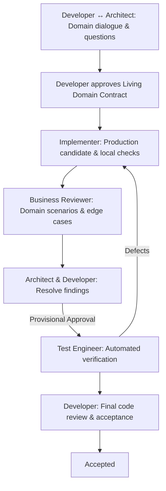

# AGAD for Codex

An integration of **Architecture-Governed Agentic Development (AGAD)** designed natively for the **Codex CLI** (`codex`).

---

## 1. Philosophy: Relaxed Agent, Wide Instructions, Human Ownership

Unlike traditional rigid agent harnesses that attempt to control the model via thousands of lines of interceptor middleware, candidate fingerprinting, tool stripping, and forced single-line JSON replies, **AGAD for Codex** embraces a relaxed, human-centered operating model:

1. **The Developer owns business meaning and final acceptance.**
2. **The Architect develops shared understanding through dialogue.**
3. **The Major AGAD Feature is Interactive Asking:** Codex natively supports conversational dialogue and interactive questions with the developer. Whenever business rules, domain terms, or trade-offs are ambiguous, the agent asks directly.
4. **Wide, Unrestricted Agent Instructions:** Subagents (Implementer, Business Reviewer, Test Engineer, Scout) operate with clear, comprehensive instructions and have full access to native tools (shell, editing, writing, testing, search).
5. **No Synthetic State Guards:** No complex state-machine enforcement code or candidate hash trackers are needed. If the instructions are clear, the agent follows them.

---

## 2. Specialized Roles

AGAD defines clear roles that collaborate seamlessly through Codex's native subagent system (`.codex/agents/*.toml`):

| Role | Agent Config | Model ID | Effort | Focus & Responsibilities |
| :--- | :--- | :--- | :--- | :--- |
| **Architect** | `architect.toml` | `gpt-6.1-sol` | `high` | Primary dialogue partner of the Developer. Asks clarifying questions, establishes domain vocabulary, proposes the Living Domain Contract, and coordinates the workflow. |
| **Implementer** | `implementer.toml` | `gpt-6.1-sol` | `medium` | Implements approved contract outcomes in production code. Full access to native tools (shell, edit, write, test). Reports clear, human-readable summaries without rigid schemas. |
| **Business Reviewer** | `business-reviewer.toml` | `gpt-6.1-sol` | `medium` | Evaluates domain scenarios, edge cases, and invariant violations *before* inspecting implementation. Ensures business alignment. Not a code-style reviewer. |
| **Test Engineer** | `test-engineer.toml` | `gpt-6-luna` | `high` | Designs and runs automated verification suites against approved contract outcomes. Reports genuine execution results and defects without weakening assertions. |
| **Scout** | `scout.toml` | `gpt-6-luna` | `low` | Fast, read-only codebase explorer for discovering conventions, existing test setups, and references. |
| **Decision Partner** | `decision-partner.toml` | `gpt-6.1-sol` | `high` | Advisory brainstorming partner for exploring architectural trade-offs and domain modeling decisions. |

---

## 3. Quickstart

### Option A: Use in this repository
Codex automatically loads `.codex/agents/` and `AGENTS.md` when launched in this directory:

```sh
cd integrations/codex
codex
```

### Option B: Install into an existing project
Run the included setup script to configure AGAD in your project:

```sh
# Set up in current project root:
./scripts/install.sh project /path/to/your/project

# Or install globally for all Codex sessions:
./scripts/install.sh global

# Or set up a dedicated AGAD profile:
./scripts/install.sh profile
```

Then simply open your project in Codex:

```sh
cd /path/to/your/project
codex
```

---

## 4. Separating AGAD Features vs Everyday Non-AGAD Tasks

You don't always want the full AGAD process (e.g. when asking simple questions, debugging a quick script, or doing casual refactoring). You can separate these workflows easily using either of these approaches:

### Method 1: The `@architect` Subagent Mention (Same Session, No Setup)
- **Normal Codex Mode**: Just start `codex` and ask questions or prompt tasks normally. The agent behaves as standard Codex without AGAD contract ceremony.
- **AGAD Feature Mode**: When you want to develop a new feature under AGAD, prefix your prompt with `@architect`:
  ```
  @architect Let's implement the order refund capability...
  ```
  This immediately routes the task to the **Architect** subagent, which leads domain dialogue, asks questions, prepares the Living Domain Contract, and orchestrates the Implementer, Business Reviewer, and Test Engineer.

### Method 2: Profile-Based CLI Switching (`codex` vs `codex-agad`)
If you prefer opening Codex directly into AGAD mode without typing `@architect`:
1. Run `./scripts/install.sh profile` to create `~/.codex/agad.config.toml`.
2. Add an alias in your `~/.zshrc` (or `~/.bashrc`):
   ```sh
   alias codex-agad="codex -p agad"
   ```
3. Usage:
   - **`codex`**: Standard, unconstrained Codex for quick questions, scratchpad work, and casual edits.
   - **`codex-agad`**: Launches directly into the AGAD Architect persona with `gpt-6.1-sol` (High effort) and the AGAD workflow.

---

## 4. The Collaborative Workflow



### Step 1: Dialogue & Intent Clarification
Start an interactive Codex session and describe the desired change:
- The **Architect** teaches back the observable outcomes.
- If domain concepts, edge cases, or boundaries are ambiguous, the Architect **asks the Developer directly**.

### Step 2: Living Domain Contract
The Architect proposes a versioned contract:
- **Intent**: The observable behavior to achieve.
- **Rationale**: Design decisions and trade-offs.
- **Vocabulary**: Precise domain definitions.
- **Architecture**: Invariants and boundary rules.
- **Requirements**: Concrete, checkable outcomes (`R1`, `R2`, ...).
- **Scope**: Disjoint production paths, test paths, and test commands.

The Developer reviews and provides explicit conversational approval.

### Step 3: Implementation
The `implementer` agent builds the approved outcomes:
- Full access to shell, editor, file tools, and local tests.
- Summarizes files changed, checks run, and outcomes satisfied in natural Markdown.

### Step 4: Business Review
The `business-reviewer` explores real-world domain scenarios and checks for edge cases or potential invariant violations. It reports alignment and surfaces any business questions back to the Architect and Developer.

### Step 5: Provisional Approval & Testing
With the Developer's provisional approval, the `test-engineer` writes and executes targeted automated tests covering the approved outcomes, reporting genuine command outputs.

### Step 6: Code Review & Acceptance
The Developer conducts human code review of the candidate diff and test results, granting final acceptance.

---

## 5. Comparison: Codex vs Oh My Pi (OMP) Integration

| Dimension | Oh My Pi (`integrations/oh-my-pi`) | Codex (`integrations/codex`) |
| :--- | :--- | :--- |
| **Enforcement Style** | Programmatic runtime guards & state validation (`controller.ts`, `validate.py`) | Clear instructions & relaxed, trusted agent execution |
| **Asking Questions** | Custom UI dialogs, tmux split-pane helper, `/agad-question` commands | Native Codex interactive conversational dialogue |
| **Tool Restrictions** | Strict tool allowlists per role, tool stripping | Full native tools; guided by role instructions |
| **Output Formats** | Rigid single-line JSON reply shapes (no prose, no fences) | Natural, expressive, human-readable Markdown |
| **Code Footprint** | ~3,500 lines of custom TypeScript & bridge scripts | Zero runtime overhead; declarative TOML agent definitions & Markdown instructions |
