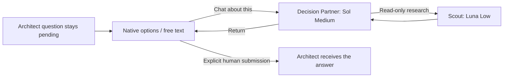

# AGAD for Oh My Pi

An experimental OMP-native plugin, isolated from the [harness-independent core](../../README.md). Targets **OMP 18.10.4**, Bun and Python 3.10+. Keep this directory inside the AGAD checkout: the Python bridge calls the unchanged core validator in `../../tools/validate.py`.

## Start

From this directory:

```sh
bun install --frozen-lockfile
bun scripts/check-models.ts
omp --no-extensions --no-prewalk --no-title --extension "$PWD" --cwd /absolute/path/to/your/project
```

This explicit launch loads AGAD for that session. It does not install a global plugin or modify your global model assignments. `AGAD_OMP_PROVIDER` defaults to `openai-codex`; a different provider may be selected only if its registry exposes the same exact model IDs and efforts. Missing access blocks execution rather than substituting a model.

Ask the Architect for one small change. It teaches back the intended outcomes, proposes a versioned Living Domain Contract, and asks for your approval of the contract, disjoint production/test paths and exact test-command argument arrays. The Architect is read-only and delegates through governed tools.

## Strict role mapping

| Role | Model ID | Effort | Capabilities |
| --- | --- | --- | --- |
| Architect | `gpt-6.1-sol` | high | Interactive coordination, read/research, governed handoffs |
| Implementer | `gpt-6.1-sol` | medium | Read/research; edit/write approved production paths |
| Business Reviewer | `gpt-6.1-sol` | medium; high for critical contracts | Read/research; business scenario discovery |
| Test Engineer | `gpt-6-luna` | high | Early read-only planning; after approval, approved test paths and exact check IDs |
| Scout | `gpt-6-luna` | low | Read-only repository/web research; no delegation |
| Decision Partner | `gpt-6.1-sol` | medium | Read-only discussion/research; may spawn only research Scouts |

The Developer is the human authority, not another model. Role definitions live in [agents](agents/); [roles.ts](src/roles.ts) is the enforced model/effort map. No fuzzy selectors, role aliases, prewalk switches, SDK fallback or automatic retry fallback are used in helper sessions. The Architect is checked before every provider request and tool call. Identity mismatch explicitly aborts the session because OMP isolates hook exceptions; a manual model/effort change outside its mapping stops AGAD execution. Generic native `task`/`eval` delegation is blocked so it cannot bypass the adapter.

## Think with a partner while a question stays open

1. Architect presents the native OMP question with answer options. You may choose an option or type your own answer.
2. Select OMP's native **Chat about this** action to consult Decision Partner.
3. Ask it to critique a proposal, compare decisions, inspect the architecture, or find evidence. It can call `agad_research`, which creates a strictly read-only Luna Low Scout. Follow-up requests include the consultation transcript, preserving the discussion.
4. Return to the original Architect question. Its ID, options, context, revision and candidate have not changed.
5. Submit your answer. Only that final answer and an optional human note go to Architect; consultation does not enter the Architect's model history or authorize work. You can explicitly include insights in your typed answer.



Cancelling preserves the pending question. Use `/agad-question` to resume it after interruption or reopening a saved session. `/agad-status` shows the current state without a model turn. While a question is pending, dependent delegation is blocked. Branch/session switches are refused during an active adapter operation; late dialog responses are checked against their original session generation.

For approvals, the human must explicitly select **Approve**. Free text such as “approve after changing X,” a timeout, cancellation, the Partner's recommendation or silence is never approval. The full proposed checkpoint, contract and scope are visible in the question context. Hosts without the rich dialog receive native selection plus text-input dialogs. Human decisions require an interactive UI; headless operation fails closed.

## Governed development

The controller reuses the core's version-2 reference validator for every transition:

`contract approval → Implementer → Business Reviewer or exact human trivial waiver → human provisional approval → Test Engineer → human code review/final acceptance`.

Early Test Engineer planning uses `agad_plan_tests` and exposes no write or check-execution tools. A review waiver is a separate human checkpoint and does not bypass provisional approval. Technical repairs and test-only corrections follow the core's distinct paths. Stalled progress or new uncertainty must return to Developer–Architect dialogue; there is no numeric repair budget.

Production candidates are fingerprints of the approved production paths. Review, testing and candidate-specific checkpoints reject changed production. Final acceptance additionally checks that test artifacts match the verified snapshot. Actual executed check results, rather than model-written PASS claims, are supplied to the core. Every passing check is bound to the same final test-file snapshot; later test edits require rerunning all required checks. No approval is synthesized from a worker's text.

Each worker is a fresh, restricted SDK session with explicit model, effort and tools, no ambient extensions, MCP, IRC, LSP, skills, rules or inherited project context files, and no generic subprocess tool. Relevant contract/task context is supplied explicitly. Write-tool calls are checked against the role's approved path scope, including symlink/traversal checks. The Partner and Scout have neither edit/write nor shell/command tools.

Test Engineer can run only check IDs whose exact argument arrays you approved with the contract. Those programs execute with your OS permissions and are trusted developer-selected programs; this plugin is not an OS sandbox. Fingerprints protect declared production scope; production paths must cover the actual production surface of the change. Role restrictions govern exposed agent tools, not a malicious user, extension or test executable running in the same process/account.

## Modules and tools

| Module | Responsibility |
| --- | --- |
| `roles.ts`, `agents/` | Exact model/effort map and role prompts |
| `dialog.ts` | Native questions, free text, consultation and explicit submission |
| `sessions.ts` | Isolated role sessions, read-only Scout delegation, role tool scopes |
| `controller.ts` | Core-gated handoffs, candidate freshness and human checkpoints |
| `scope.ts` | Path checks and production/test artifact fingerprints |
| `core.ts`, `scripts/core_bridge.py` | Transport to the existing core, without duplicating its policies |
| `index.ts` | OMP registration, lifecycle hooks, commands and parent-session guard |

Architect tools: `agad_contract`, `agad_question`, `agad_checkpoint`, `agad_delegate`, `agad_plan_tests`, `agad_event`, `agad_status`. Developer-only event authority is created inside interactive checkpoints; there is no tool accepting arbitrary developer approval records. Worker report authority comes from the specific mapped role session.

The adapter stores snapshots under the namespaced OMP custom session entry `agad.omp.state.v1`, including pending question and consultation. Resume/branch restoration replays the stored core record. Core artifact references still require meaningful human review; fingerprints and UI attribution strengthen the reference checks but do not prove business correctness.

[Example contract](examples/contract.json) and [scope/command declaration](examples/scope.json) illustrate the tool inputs for a fictional reservation change. They are examples, not approved policies for your application.

## First-version scope

Use one independently scoped change per OMP session. Contracts must include only in-scope requirement records; keep excluded scenarios and questions in the rationale or human dialogue. Scope amendments require a new contract revision. Scopes must be nonempty for production and disjoint from test paths. Reserved `.git`, `.omp`, `node_modules` paths and symlink write paths are excluded. Edit dialects without one explicit `path` are rejected; the ordinary write tool remains available within approved scope.

The adapter is local to this checkout and is not published to npm. This is a first technical implementation, not a claim that an entire production change has passed final human acceptance. It has automated controller/dialog/permission tests and a real installed-host loading check; a live model-driven coding and terminal-interaction acceptance session remains to be performed by the developer.

## Validation

```sh
bun run typecheck
bun test
python3 ../../tools/validate.py ../../examples/accepted.json
python3 -m unittest discover -s ../../tests -v
python3 scripts/smoke-rpc.py
```

`check-models.ts` checks exact registry/authentication availability without prompting a model. `smoke-rpc.py` loads the installed OMP host, verifies Architect mapping and command registration, and sends no model prompt. Session unit tests use SDK doubles so they verify isolation/delegation without spending model tokens. Dialog tests cover native chat routing, cancellation, timeout, free text and question identity; they do not claim physical terminal-key testing.

Implementation was grounded in Context7 and verified against upstream tag `v18.10.4`, commit `687892d1046ecaf18829b45f5b86928a308258f4`:

- [Extension API and tool execution signature](https://github.com/can1357/oh-my-pi/blob/v18.10.4/packages/coding-agent/src/extensibility/extensions/types.ts)
- [Native ask dialog and Chat about this result](https://github.com/can1357/oh-my-pi/blob/v18.10.4/packages/tui/src/overlays/ask-dialog.ts)
- [Restricted SDK session options](https://github.com/can1357/oh-my-pi/blob/v18.10.4/packages/coding-agent/src/sdk.ts)
- [Agent discovery and model overrides](https://github.com/can1357/oh-my-pi/blob/v18.10.4/docs/task-agent-discovery.md)
